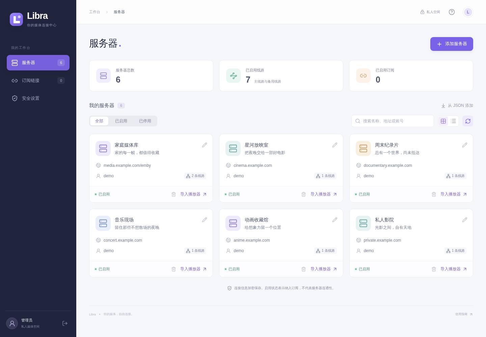

# Libra

你的媒体，自由连接。

一个部署在 Cloudflare Workers 上的私人 Emby 服务器管理台。集中维护账号和线路，生成播放器导入链接，或通过可订阅的 JSON 地址分发配置。界面为独立设计，支持手机与桌面。

本项目与同名 **Libra 播放器**是独立项目。

[](https://deploy.workers.cloudflare.com/?url=https://github.com/cloudberry99/libra)



## 功能

- Emby 服务器的添加、编辑、删除、启停、搜索，以及单条 JSON 配置导入。
- 主线路、最多 32 条备用线路、备注和可选 Logo；支持局域网、IPv6、端口与反向代理路径。
- 从主线路登录获取服务器公布的备用线路，固定 `LibraManager` UA 和持久化 DeviceId，去重后合并到表单。
- 可维护的图标库，支持跨图库搜索、分页选择 Logo 和手动输入图片 URL；可选 GitHub Token。
- Libra、SenPlayer、EplayerX、Rex、Hills 和 RodelPlayer（小幻播放器）的 URL Scheme 导入。
- 多条公开订阅：全部或指定服务器、随机或自定义后缀、停用、删除、更换后缀。
- 订阅二维码、复制链接、下载二维码。二维码完全在浏览器本地生成。
- 删除或更换订阅后释放旧后缀，允许重新分配。
- 单管理员、强密码、加密 KV 存储、登录限流、HttpOnly 会话与跨站请求保护。
- 未保存的表单在关闭或离开页面前确认；保存、复制和删除结果通过独立浮层提示。

## 部署到 Cloudflare

需要一个 Cloudflare 账号。使用 Workers，无需 VPS、数据库服务或单独部署前端。

### 一键部署

1. 点击上面的部署按钮，关联 GitHub 账号并创建仓库。
2. 设置 Worker 名称和 `APP_SECRET`。使用密码管理器生成至少 32 位随机密钥，推荐 64 位十六进制字符串；也可以在本机执行 `openssl rand -hex 32`。
3. 构建命令填写 `npm run build`，部署命令填写 `npm run deploy`。Node.js 使用 24。
4. 部署完成后访问 Worker 首页，输入同一份部署密钥，设置自己的管理密码。

KV 绑定名称为 `LIBRA_KV`。仓库中的配置没有任何账号 ID 或 KV ID，Wrangler 会在首次部署时自动创建并绑定 KV；以后部署复用已有绑定。参见 Cloudflare 的[资源自动配置说明](https://developers.cloudflare.com/workers/wrangler/configuration/#resource-provisioning)和[部署按钮说明](https://developers.cloudflare.com/workers/platform/deploy-buttons/)。

`APP_SECRET` 是 **Worker 运行时 Secret**，同时用于首次初始化验证和数据加密。不要仅将它作为构建环境变量设置，也不要提交到 Git。部署按钮会依据 `.dev.vars.example` 提示配置 Secret。

### Fork 后连接 Git 仓库

在 Cloudflare 控制台中进入 **Workers & Pages → 创建应用 → 导入仓库**，选择 Fork 后的项目，根目录保持 `/`，使用上述构建与部署命令。

在 Worker 的 **设置 → 变量和机密** 中添加 `APP_SECRET`，类型选择 Secret；首次部署如果提示缺少必需 Secret，添加后重新部署即可。关联完成后，向所选分支推送代码即可触发更新。

如果已经用 CLI 部署本项目，可在现有 Worker 的构建设置中连接仓库。保持 Worker 名称、KV 绑定和 `APP_SECRET` 不变，就能保留现有数据。

### CLI 部署

```bash
git clone https://github.com/cloudberry99/libra.git
cd libra
npm ci
npx wrangler login
npx wrangler secret put APP_SECRET
npm run deploy
```

首次设置 Secret 时，Wrangler 可能提示创建尚不存在的 Worker，按提示创建即可。不要把密钥直接写进命令行参数。

首次打开页面时没有默认管理密码。必须提供部署密钥才能初始化，避免公开上线后被第一个访客注册。管理密码需要 8–128 位，包含字母、数字和符号。

## 使用

1. 在「服务器」添加 Emby 主地址、账号与备用线路。
2. 点击卡片上的「导入播放器」，选择当前设备已安装的播放器。也可以复制导入链接。
3. 在「订阅链接」创建链接，为客户端选择全部服务器或指定服务器。
4. 复制订阅地址，或打开二维码让客户端扫描。二维码中是完整订阅 URL，并非服务器配置本身。

停用服务器只会将其移出订阅响应，卡片仍可手动生成播放器链接。「全部服务器」订阅会自动包含以后新增的已启用服务器；「指定服务器」按选择顺序返回。

公开链接没有登录验证，**持有链接的人可以读取其中的账号密码**。随机后缀默认使用 128 位随机数；自定义后缀允许 8–64 位字母或数字，包括纯字母、纯数字。请妥善保管链接与二维码。

少于 16 位、纯数字或重复字符的自定义后缀会显示弱后缀提示，仍可保存。优先使用随机生成的后缀；长度足够也不代表有规律的字符串难以猜测。

删除、更换后缀后，旧后缀可以重新分配。如果重新分配，仍持有旧链接的客户端会读取新订阅对应的配置。

## 图标库与 Logo

在「图标库」页面添加、编辑或删除图库名称与 JSON 地址，也可以浏览图标并复制图片地址。服务器编辑框中的「从图库选择」默认搜索全部图库，支持中文、忽略英文大小写、多关键词匹配，以及按图库筛选。完整名称和名称开头匹配优先；每页 60 个图标、图片懒加载，搜索不会逐字发起网络请求。选中后回填 Logo 地址，保存服务器时才生效；也可以手动输入 HTTPS 图片地址或清除 Logo。

首次初始化会将以下三个图库写入 KV。初始化不依赖第三方网络。此后以 KV 中用户维护的列表为准，包括空列表，重新部署不会恢复被删除的默认图库。读取工作台和图库不会写入默认值，避免 KV 缓存的旧空值覆盖用户修改；从尚未包含图库的版本升级时，可在后台手动添加下面的地址。删除图库不影响已经保存的服务器 Logo。

- [白糖图标库 · 圆形](https://raw.githubusercontent.com/baiitang/Sakura/main/Fileball/Yuan/tubiao.json)
- [白糖图标库 · 方形](https://raw.githubusercontent.com/baiitang/Sakura/main/Fileball/Fang/tubiao.json)
- [离歌图标库](https://raw.githubusercontent.com/lige47/QuanX-icon-rule/refs/heads/main/lige-emby-icon.json)

图标及其名称由各图库作者维护，本项目仅保存图库地址和选中的图片 URL。自定义图库使用相同格式：

```json
{
  "name": "我的图标库",
  "icons": [{ "name": "家庭影院", "url": "https://example.com/home.png" }]
}
```

最多维护 30 个图库。图库地址需为公网 HTTPS 域名；单个 JSON 不超过 2 MiB、最多 5,000 个条目。不符合 HTTPS 要求、格式错误或重复的图标会被过滤。读取超时为 10 秒，重定向逐跳校验；单个图库失败不影响其他图库的搜索与选择。列表由服务端读取，不要求源站开启 CORS；图标元数据在 Cloudflare Cache API 中缓存 10 分钟，「刷新图标」可重新拉取源文件。后台接口通过 `X-Libra-Icon-Cache: HIT/MISS` 报告实际缓存命中。浏览器内存也保留成功结果 10 分钟，关闭选择器后重开无需重复下载；退出登录、会话过期或更换／移除 Token 会清除内存缓存，失败结果不缓存。

### GitHub Token（选填）

在「图标库 → GitHub Token」中保存、更换或移除 Token。Token 使用原有部署密钥加密保存在 KV，后台仅返回配置状态，不回显 Token，也不会将其加入图片 URL、公开订阅、播放器链接或日志。

保存 Token 前会通过 GitHub 官方 `/user` 接口验证有效性；失败时保留原设置，移除 Token 需要确认。填写 Token 后，GitHub raw/blob 图库地址会转换为官方 Contents API 的只读请求；Token 仅发给 `https://api.github.com` 的验证与文件读取端点，第三方图库和跨域重定向不会收到 Token。API 返回 401、403 或 404 时，会回退到原始公开 raw 地址匿名读取，兼容已失效的 Token 和包含斜杠的分支名；私有文件仍需要有效权限。更换或移除 Token 会使用新的缓存版本。GitHub 支持通过此 API 返回文件原文；访问私有仓库时，细粒度 Token 需要对应仓库的 Contents 读取权限，无需写权限。参见 [GitHub Contents API](https://docs.github.com/en/rest/repos/contents#get-repository-content)。

Token 主要提高 [GitHub API 请求额度](https://docs.github.com/en/rest/using-the-rest-api/rate-limits-for-the-rest-api)，不保证提升单张图片下载速度。图片仍由浏览器直接加载公开 HTTPS 地址，Token 用于图标目录 JSON 的服务端读取；不填写时，默认的公开 raw 图库也可使用。

## 获取备用线路

在服务器编辑框中填写主线路、用户名和密码，点击「获取备用线路」。Worker 使用 `User-Agent: LibraManager` 登录 Emby，再调用服务器的 `/emby/System/Ext/ServerDomains` 扩展接口；兼容带反向代理基础路径的地址和未使用 `/emby` 前缀的登录路径。请求由服务端发出，无需浏览器跨域授权，主线路需要能从公网访问。

Emby 的 `Client`、`Device` 均为 `LibraManager`。部署初始化时随机生成一个 UUID DeviceId，加密存入 `settings:emby-device:v1`，本部署的全部服务器共用；重新部署不会更换。已有部署升级后首次使用时补入一次。不要删除这个键，否则会生成新的设备标识。服务器编辑框的「客户端身份」可查看并复制 DeviceId，展开只读取本地部署设置，不会登录 Emby。共享服务器可能限制客户端或设备数量，使用前请确认其规则，必要时将 LibraManager 和此 DeviceId 加入白名单。

如果主线路使用 HTTP，Cloudflare 到 Emby 的连接不加密，账号与密码会明文发送；每次获取前都需要确认，取消不会发出获取请求。优先使用服务器提供的 HTTPS 主线路。

获取结果合并到当前表单，保留主线路、手动线路、已有名称和排序，规范化后去重；保存后才更新订阅。最多保存 32 条备用线路，超出时可搜索并分页选择，每页 20 条；跨页和搜索会保留勾选。支持全选匹配线路，匹配数量超过剩余容量时，按钮改为按原顺序选满可用容量，不覆盖已选项；也可一键清空选择。接口不支持、登录失败或超时不会清除原配置。登录 Token 仅用于这次请求，随后尝试注销，不保存到 KV，也不返回浏览器；不跟随重定向转发凭据，不访问返回的备用地址。请求超时 15 秒，注销最多额外 2 秒，响应最多 512 KiB／512 条。

这不是 Emby 原生的完整线路清单，只能获取服务器运营者通过扩展公布的地址；未部署此接口的服务器仍需手动填写。本功能由用户点击触发，不定时轮询。协议参考 [emby_ext_domains](https://github.com/uhdnow/emby_ext_domains) 与 [Emby 用户认证文档](https://dev.emby.media/doc/restapi/User-Authentication.html)。

## 订阅接口

```http
GET https://your-worker.workers.dev/<suffix>
```

成功返回 `200 application/json`，响应是配置数组；不存在、已删除或停用返回 `404`。没有已启用服务器时返回 `[]`。支持 `HEAD`、`OPTIONS` 和跨域 GET，不依赖 Cookie。响应设置 `Cache-Control: no-store`。

以下全部是虚构示例：

```json
[
  {
    "type": "emby",
    "name": "家庭媒体库",
    "note": "家庭影音",
    "logo": "https://example.com/logo.png",
    "credentials": { "username": "demo", "password": "example-password" },
    "primary": { "url": "https://media.example.com:8920/emby", "name": "主线路" },
    "alternates": [
      { "url": "http://192.168.1.10:8096", "name": "家中直连" },
      { "url": "https://backup.example.com/emby", "name": "白线路" }
    ]
  }
]
```

必填字段只有 `type: "emby"` 和 `primary.url`。服务器名称、备注、Logo、账号、密码、线路名称与备用线路都可以省略。每条备用线路必须提供 `url`，最多 32 条。空 Logo 不输出字段；新保存的 Logo 只接受 HTTPS 地址。升级前保存的 HTTP Logo 在读取时自动移除，包括后台与公开订阅；下一次保存目录时持久化清理结果。

密码原样保留，包括首尾空格、中文、`&`、`+`、`#` 和 `%`。编辑页面填写密码后自动提供，留空则省略 `password` 字段。通过 JSON 导入或接口显式提供 `""` 时仍保留空密码，与省略密码不同。其他展示字段去除首尾空白。

线路只接受完整 HTTP(S) 基础地址，禁止内嵌账号密码、查询参数、fragment、未编码空白和反斜杠。端口为 1–65535。域名大小写、默认端口、末尾斜杠会规范化；规范化后重复的线路保留第一条。备用线路应指向同一台可信 Emby 服务器，本项目不验证服务器身份或连通性。

响应只包含上述客户端配置，不包含后台记录 ID、版本、启停状态或登录会话。

## 播放器协议

| 播放器      | 导入入口                           | 支持范围与说明                                                                          |
| ----------- | ---------------------------------- | --------------------------------------------------------------------------------------- |
| Libra       | `libra://import/server?v=1&data=…` | UTF-8 JSON → Base64URL（无填充）；保留所有线路和凭据，按 v1 规范排除 Logo               |
| SenPlayer   | `senplayer://importserver?…`       | 服务器名称、备注、图标、账号、完整主地址及备用线路                                      |
| EplayerX    | `eplayerx://add-or-update?…`       | 名称、备注、账号、主地址、备用线路；备用地址或名称含原始逗号/分号时提示手动处理         |
| Rex         | `rex://import?…`                   | 主地址拆分为 scheme/host/port，附账号及编号备用线路；title 为主线路名称，默认「主线路」 |
| Hills       | `hills://import?…`                 | 主地址拆分为 scheme/host/port，附账号和备用线路                                         |
| RodelPlayer | `rodelplayer://import?…`           | 与 Hills 同类参数，界面名称为小幻播放器                                                 |

Libra 适配依据使用者提供的 v1 协议，解析链接后由播放器展示添加表单。其余五种适配参考公开的 [emby-keepalive 协议生成逻辑](https://github.com/SolarisAA/emby-keepalive)，独立实现，不复制其界面或业务代码。Rex 的参数参考仓库的 [rexUrl 适配器](https://github.com/SolarisAA/emby-keepalive/blob/main/public/index.html#L918-L946)，未命名的备用线路使用「线路1」「线路2」等默认名称。

Rex / Hills / RodelPlayer 已知参数未明确支持主线路的反向代理基础路径。本项目遇到 `/emby` 这类主线路时会提示手动导入，避免静默丢掉路径。其他播放器未定义的字段不会随意附加。六种 Scheme 均有编码测试，但没有在真实 iOS/Windows 播放器中自动验证；播放器版本可能影响接收行为。

## 安全与存储边界

- 全部业务配置存储在 `LIBRA_KV`。服务器合并为一份加密目录 `catalog:servers:v1`；图库列表使用 `catalog:icon-libraries:v1`，GitHub Token 使用 `settings:github:v1`，均加密存储；订阅、后缀索引、管理员和会话分别存储。
- 记录使用 AES-256-GCM 加密、随机 IV，并绑定 KV 键名作为附加认证数据。新写入的 v2 密文使用 HKDF-SHA256 从部署 Secret 派生密钥；同时兼容读取旧版 v1 密文。每个 isolate 最多缓存 4 个不可导出的 CryptoKey，不缓存解密后的业务数据。
- 管理密码保存为随机盐 + PBKDF2-SHA256 校验结果，使用 100,000 次迭代及部署 Secret 提供的 HMAC pepper；不会保存明文管理密码。
- 会话使用 256 位随机令牌，KV 中只以其 SHA-256 摘要索引，最长 12 小时。HTTPS 下使用 `__Host-libra_session` Cookie，带有 Secure、HttpOnly、SameSite=Strict、Path=/ 且不设置 Domain。本地 HTTP 开发使用普通 Cookie 名。
- 写接口校验同源 Origin、自定义请求头与 JSON 类型；请求体上限 128 KB。前后端均校验配置。
- 登录和公开接口使用 Cloudflare Rate Limiting binding；限流按 IP、边缘位置近似执行，不是全网强一致计数器。
- 页面禁止被 iframe 嵌入，使用 CSP，不加载第三方脚本、字体或二维码接口。用户填写的 HTTPS Logo 会由浏览器请求，使用 `no-referrer`；图片站点仍能看到管理员 IP，可留空避免外部请求。
- 管理与订阅响应不缓存、不收录。异常日志只记录状态码、白名单中的错误名称和固定路由类别，不记录异常原文、请求体、密码或 URL（包括订阅后缀）；Worker invocation logs 与 traces 关闭。

服务器和图库目录均包含整体修订号，随 `/api/dashboard` 的 `revisions` 下发。增删改必须携带对应的 `catalogRevision`，与服务端读到的修订号不一致时返回 409；写入成功返回新修订号，编辑和删除仍同时校验单条记录的 `version`。这可以拒绝“客户端看到新目录、当前节点读到旧目录”以及已被服务端发现的跨记录冲突，创建记录也受保护。旧数组目录使用内容摘要作为初始修订号，直到首次明确写入时升级。

**KV 是最终一致存储，修订号不是原子锁。** 配置更新、删除、停用、退出登录与密码变更在不同边缘节点传播可能需要一分钟或更久。如果客户端和服务端同时读到同一个旧修订号，或者两个请求同时校验通过后写入，仍可能覆盖其他修改；后缀占用和数量检查也不是原子的，登录后跨节点可能暂时看不到新会话。本项目面向单管理员，请串行操作，避免多标签页、多设备同时管理。需要彻底消除并发丢失时应使用 Durable Object 或 D1 协调，本版按部署要求保留纯 KV。详见 [KV 的一致性说明](https://developers.cloudflare.com/kv/concepts/how-kv-works/)。

KV 对同一键的写入限制为每秒 1 次。快速连续保存可能返回 `KV_WRITE_RATE_LIMIT` 和 `Retry-After: 1`。前端等待 1.1 秒后只重试一次，携带原有记录版本和目录修订号；如果期间有更新，仍返回 409，不会自动换成新版本强制覆盖。登录限流、Emby 限流和其他 429 不自动重试。服务端优先识别结构化状态码和嵌套异常，兼容旧运行时的错误文本。参见 [KV 写入限制](https://developers.cloudflare.com/kv/api/write-key-value-pairs/#limits-to-kv-writes-to-the-same-key)。

撤销订阅不能删除客户端已经拉取的密码。如果配置已经泄漏，需要到 Emby 端更换凭据。

目前限制 200 台服务器、50 条订阅，服务器目录的 UTF-8 JSON 总大小不超过 8 MiB。迁移完成后，每次有效公开订阅只读取 3 个 KV 键（后缀索引、订阅、服务器目录），不随服务器数量增加，也无需 `list`。后台订阅列表使用每批最多 100 个键的批量读取；计数只列举键，不读取或解密订阅内容。批量读取减少往返次数，**计费仍按实际读取的键数计算**。持有链接的人仍可能消耗额度，按 IP 限流不等于全站预算保护；请结合 [Cloudflare KV 额度](https://developers.cloudflare.com/kv/platform/limits/)设置合理的客户端刷新频率。

删除服务器不会阻止引用它的订阅启停或更换后缀；缺失的服务器不出现在订阅响应中。只有新建或主动更改服务器选择时，才检查所选服务器是否存在。

## 备份和恢复

同时备份 KV 数据和 `APP_SECRET`。**重新部署时不要重新生成 APP_SECRET**，否则已有记录将无法解密。不要把这两份备份公开发布。

### 旧版本升级

1. 升级前备份完整 KV 和原 `APP_SECRET`，升级时沿用原密钥。迁移期间只在一个设备上串行操作。
2. 已经初始化过、但尚无图标库的旧部署，不会自动补入默认库。可在「图标库」中手动添加上文的三个内置地址；登录和读取操作不会重新写入默认库，也不会恢复用户主动删除的库。
3. 如果 KV 中只有旧 `server:*` 记录，还没有 `catalog:servers:v1`，先确认后台服务器列表完整，再打开任意已有服务器，点击「保存更改」即可触发合并，无需改动字段。首次明确增删改都会迁移，读取后台或公开订阅不会回写；迁移前公开订阅仍读取旧记录，尚未获得单目录读取的性能收益。旧数组目录也在首次明确保存时升级为带修订号的结构。
4. 新目录存在后（包括空目录），旧 `server:*` 密文不再读取或更新，仅保留为升级备份。等待 KV 传播完成（通常至少一分钟，可能更久），确认新目录包含全部服务器、后台及公开订阅正常，并再次备份完整 KV 与原密钥后，可在 Cloudflare 控制台手动删除旧 `server:*` 键。**只清理这个前缀**，不要删除目录、订阅、后缀索引、设置或会话键。尚未写入新目录时不能清理旧记录，离线升级备份仍需保留。

新写入的 v2 密文不能被旧版程序读取。回退到旧版时应配套恢复升级前的完整 KV 备份，而不是仅回退代码或删除目录键。不要将 `server:*` 升级备份当作当前数据。

如果出现「部署密钥与已有数据不匹配」，接口返回 `503` 与 `DEPLOYMENT_KEY_MISMATCH`。请恢复加密现有数据时使用的原 `APP_SECRET` 后重新部署；错误密钥不会触发重新初始化或清空 KV。密文损坏也可能产生相同提示。

忘记管理密码时，可以通过有权限的 Cloudflare 控制台，仅删除 `LIBRA_KV` 中的 `admin` 键，再凭原有部署密钥重新初始化。不要删除服务器和订阅记录；旧会话会因新的管理员版本失效。KV 的传播延迟同样适用于此操作。

## 本地开发与验证

使用 Node.js 24（最低 22）。

```bash
npm ci
cp .dev.vars.example .dev.vars
# 编辑 .dev.vars，填写独立的本地 APP_SECRET
npm run dev
```

Wrangler 会为本地开发创建隔离的 KV。修改前端后重新运行构建即可更新内嵌资源；不要将本地开发绑定到生产 KV。

```bash
npm run format:check
npm run check
npx playwright install --with-deps chromium
npm run test:browser
npx wrangler deploy --dry-run
```

测试覆盖配置校验、Unicode 和特殊字符、六种 Scheme、密码与加密、旧密文迁移、HKDF 缓存、200 台服务器的读取次数、鉴权与 CSRF、限流、密钥不匹配及日志脱敏、订阅数据范围、更新删除和后缀复用。浏览器测试使用独立的临时 Worker / KV，覆盖首次初始化、服务器与订阅管理、删除被引用服务器后启停订阅、弹窗关闭后提示可见、未保存内容确认、HTML 错误页与网络异常、播放器链接、二维码解码与下载，以及 1440 px / 390 px 界面。CI 同时检查格式和重新生成类型后的差异。

图标库测试另外覆盖默认数据只初始化一次、编辑删除、跨图库中英文搜索与排序、分页与部分加载失败、手动 Logo、Token 加密与脱敏、GitHub 仓库重定向、跨域凭据隔离、缓存刷新与凭据版本、下载体积和超时限制。

后续回归覆盖整个目录的新增／修改／删除冲突、节点旧读的拒绝与无写入迁移、HTTP Logo 清理、KV 429 的单次重试、浮层与新弹窗的顶层顺序、Token 删除确认与有效性验证、斜杠分支和失效 Token 的匿名回退、跨组件图库缓存及注销失效。备用线路测试覆盖认证头、固定 DeviceId、精确保留密码、路径兼容、仅主线路接收凭据、注销、超时／体积限制，以及桌面合并和手机选择超额线路。

前端使用 React、Lucide 与本地二维码库；构建时将哈希命名的 JS/CSS 内嵌为 Worker 静态响应，只需部署一个 Worker。业务数据始终通过 KV 绑定访问，不依赖浏览器存储。

```text
src/client/pages/  服务器、订阅、安全与登录页面
src/client/dialogs/  编辑、导入、二维码与确认对话框
src/client/components/  表单控件、弹窗与独立提示浮层
src/client/styles/  按组件与响应式规则组织的样式
src/shared/        客户端配置校验、播放器协议
src/worker/        路由、认证、加密与 KV
scripts/           构建与临时浏览器测试服务
tests/             协议、安全、接口与浏览器测试
wrangler.jsonc     可直接 Fork 的 Cloudflare 配置
```

许可证：[MIT](LICENSE)。
